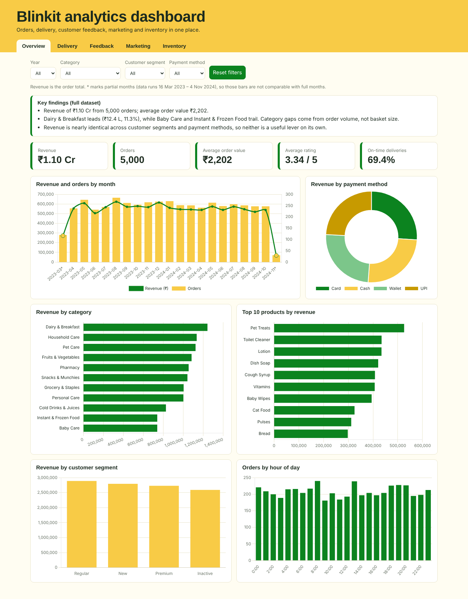
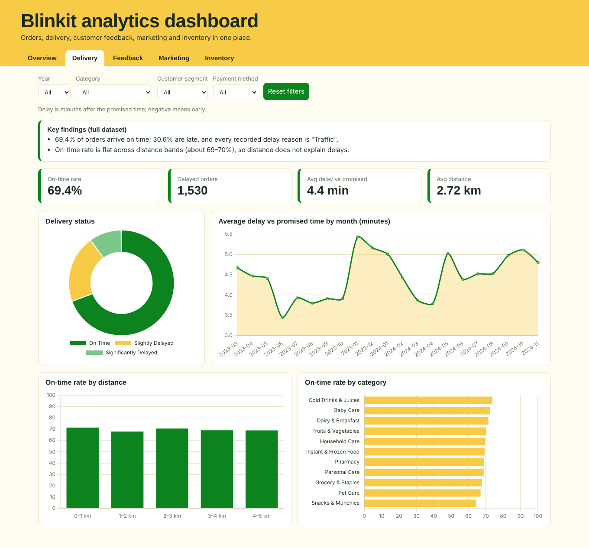
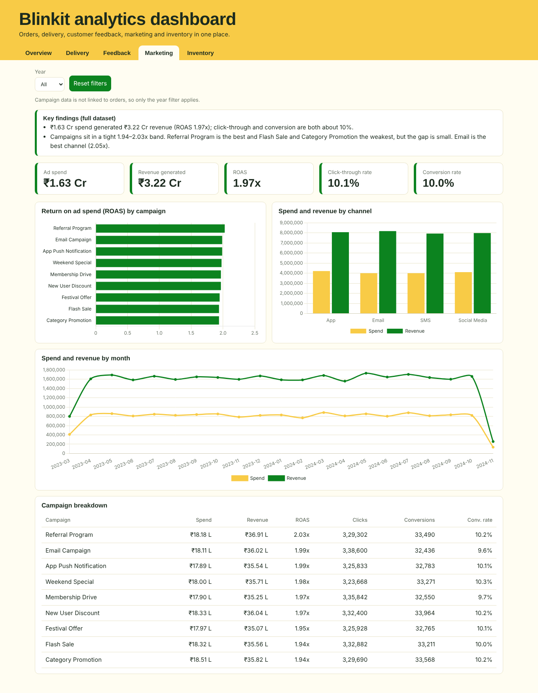

# Blinkit Analytics Dashboard

An end-to-end analysis of a quick-commerce business: data cleaning, SQL, exploratory analysis in Python, and an interactive dashboard covering sales, delivery, customer feedback, marketing and inventory.

**[Live dashboard](https://sona-rajendren.github.io/Blinkit-Analytics-Dashboard/)** · **[Analysis notebook](notebooks/01_eda_and_cleaning.ipynb)** · **[SQL queries](sql/queries.sql)**



## Business questions
1. How much revenue is generated, and which categories, customer segments and payment methods drive it?
2. How reliable is delivery, and what explains late orders?
3. Does delivery performance affect customer ratings?
4. Which marketing campaigns and channels give the best return?
5. Where are inventory losses highest?

## Key findings
| Area | Finding |
|---|---|
| Sales | ₹1.10 Cr revenue from 5,000 orders; average order value ₹2,202. Monthly revenue is flat at about ₹5.6 lakh. |
| Categories | Dairy & Breakfast leads (11.3% of revenue); Baby Care and Instant & Frozen Food trail. Differences come from order volume, since basket size is similar across categories. |
| Segments and payments | Each segment and payment method contributes 23–27% of revenue, so none stands out. |
| Delivery | 69.4% of orders are on time; 30.6% are late. Distance does not explain lateness (chi-square p = 0.52), and every recorded delay reason is "Traffic". |
| Feedback | Average rating 3.34 / 5. Late orders are rated the same as on-time ones (p = 0.55), which suggests ratings in this dataset are independent of delivery. |
| Marketing | ₹1.63 Cr spend returned ₹3.22 Cr (ROAS 1.97x). Campaigns range only from 1.94x to 2.03x. Referral Program (2.03x) and the Email channel (2.05x) lead slightly. |
| Inventory | Recorded damage is about 59% of received stock, and damaged units exceed received units in 39% of records. This indicates a data-capture problem, so the figures need validating before use. |

### Recommendations
- Grow order frequency in low-volume categories rather than basket size.
- Record richer delay reasons (rider, store preparation, weather) and review promised-time estimates, since "Traffic" alone is not actionable.
- Shift a test budget towards Referral and Email, and A/B test, because the gaps between campaigns are small.
- Fix inventory damage capture before analysing losses.

## Data
Eight CSV tables in `data/raw/`: orders, order items, products, customers, delivery performance, customer feedback, marketing performance and inventory (5,000 orders from 16 Mar 2023 to 4 Nov 2024, 2,500 customers, 268 products).

> **The data is synthetic.** Names, emails, phone numbers and addresses are fake, and results describe this dataset, not the real Blinkit business.

### Data quality notes
- No duplicates or broken keys; each order has exactly one item, delivery record and feedback row, so joins cannot duplicate revenue.
- `order_total` matches `quantity × unit_price` in only 0.14% of orders. Revenue uses `order_total`.
- March 2023 and November 2024 are **partial months**; they are flagged (marked with `*`) in the dashboard and notebook.
- `delivery_time_minutes` is the delay against the promised time (negative = early), not the delivery duration.
- Marketing revenue (₹3.22 Cr) is about 3x total order revenue (₹1.10 Cr), so the two sources do not reconcile and are analysed separately.
- Inventory damage figures are implausible (see above).

## Dashboard
Five tabs (Overview, Delivery, Feedback, Marketing, Inventory) with filters for year, category, customer segment and payment method, KPI cards and a findings panel per tab. Built with HTML and Chart.js; it runs entirely in the browser.

| Delivery | Marketing |
|---|---|
|  |  |

## How to run
```bash
git clone https://github.com/sona-rajendren/Blinkit-Analytics-Dashboard.git
cd Blinkit-Analytics-Dashboard
python -m venv .venv && source .venv/bin/activate   # Windows: .venv\Scripts\activate
pip install -r requirements.txt

python src/analysis.py   # joins tables, writes outputs/, charts and dashboard/data.js
python src/run_sql.py    # loads CSVs into SQLite and runs sql/queries.sql
jupyter notebook notebooks/01_eda_and_cleaning.ipynb
```
Open `dashboard/index.html` in a browser to view the dashboard (internet needed for the Chart.js CDN).

## Project structure
```
├── data/
│   ├── raw/                 # 8 source tables
│   └── processed/           # orders_enriched.csv (joined, order level)
├── notebooks/
│   └── 01_eda_and_cleaning.ipynb   # data quality checks, EDA, statistical tests, conclusions
├── sql/queries.sql          # 9 analysis queries
├── src/
│   ├── analysis.py          # data pipeline, summary tables, charts, dashboard data
│   └── run_sql.py           # SQLite loader and query runner
├── dashboard/               # index.html + data.js
├── outputs/                 # summary CSVs, charts, SQL results
├── docs/screenshots/
└── requirements.txt
```

## Tools
Python (pandas, NumPy, Matplotlib, SciPy), SQL (SQLite), Jupyter, HTML/CSS/JavaScript, Chart.js.

## Limitations and next steps
- Synthetic data: ratings are independent of delivery, and campaign results are almost uniform, so conclusions are limited.
- One item per order and no cost data, so basket analysis and profit analysis are not possible yet.
- Next: forecast monthly orders, model late-delivery risk once richer features exist, and add profit analysis using product margin.

## Author
**Sona Rajendren**, MCA student at Presidency University, Bengaluru · [GitHub](https://github.com/sona-rajendren)
